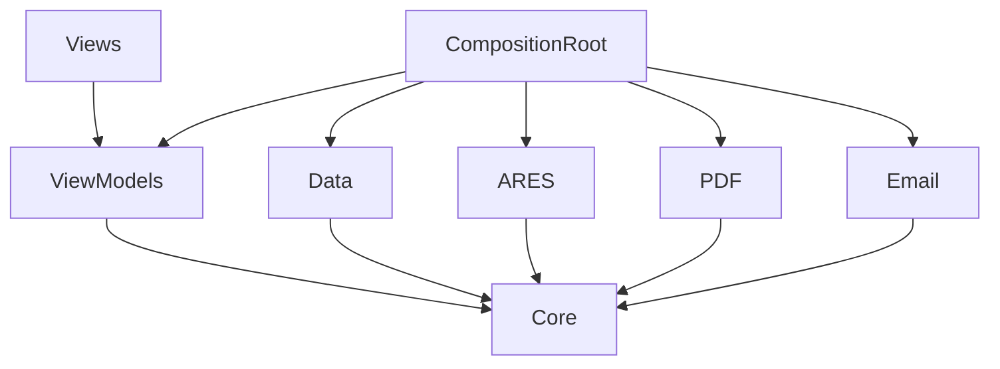
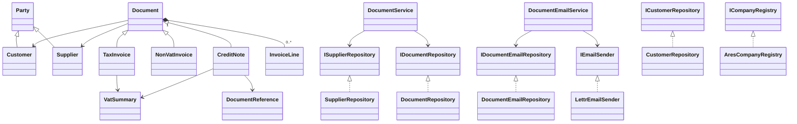
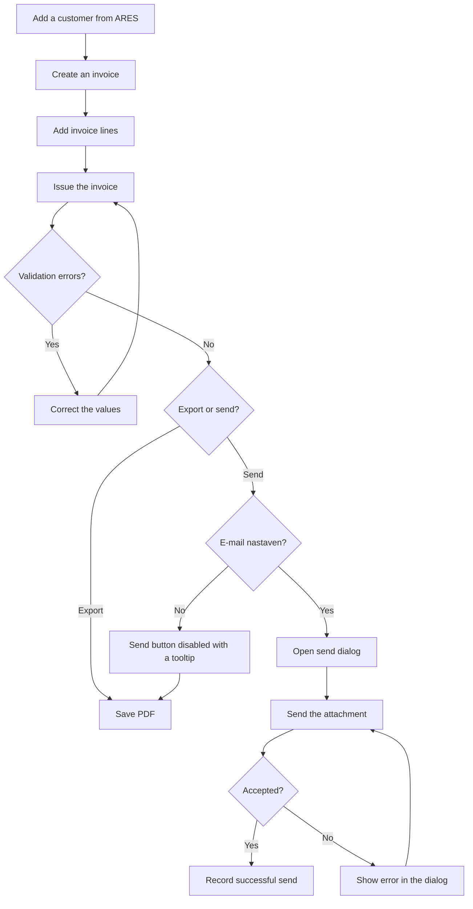

# Invoicing

A Czech desktop app for maintaining supplier and customer records, issuing VAT invoices, non-VAT invoices and credit notes, and exporting PDF documents. Invoice PDFs include QR Platba. ARES supplies company details and optional Lettr integration sends PDFs by e-mail.

## Requirements

- .NET 10 SDK
- Docker with Docker Compose v2 or newer
- Rider or another .NET IDE
- `zip` or Python 3 for the Windows archive

On CachyOS, install the main tools with `paru -S dotnet-sdk docker docker-compose`. Start Docker and make sure your account can run Docker commands.

## Setup

1. Run `cp .env.example .env`.
2. In `.env`, set `DATABASE_PATH` to the absolute path of `data/invoicing.db` in this repository. Relative paths are resolved beside the running executable.
3. Run `docker compose run --rm flyway`. On Linux, if your user or group ID differs from 1000, export the IDs first with `export UID; export GID=$(id -g)` in Bash.
4. To start with sample records in an empty database, run `docker compose --profile demo run --rm flyway-demo`.

Debug builds copy the local configuration beside the executable. Publish output uses a separate configuration copied from the example by the release script. Real environment variables override file values. Keep the local `.env` out of version control.

## E-mail setup

Create a Lettr account, obtain a sandbox key (`lttr_sandbox_…`), and set `LETTR_API_KEY` and `EMAIL_FROM_ADDRESS` in `.env`. Restart the app. Lettr redirects sandbox messages to the key owner's address and uses a pre-verified sender domain. For regular delivery, use a live key and a sender address on a domain verified in Lettr.

## Run in Rider or from the command line

Open `Invoicing.sln` in Rider and run `Invoicing.App`. For XAML previews, use Rider's Avalonia support and the AvaloniaRider plugin.

```sh
dotnet run --project src/Invoicing.App
```

## Tests

```sh
dotnet test
dotnet format --verify-no-changes
```

The tests use temporary SQLite files, bundled fixtures and fake HTTP handlers. They cover VAT, validation, lifecycle, transactions, ARES and Lettr serialization, and rendering PDF and QR bytes.

## Windows release

```sh
scripts/build-windows-release.sh
```

Extract `artifacts/release/Invoicing-win-x64.zip` and run `Invoicing.App.exe` from the extracted folder. The archive includes a self-contained runtime, a migrated database and configuration with e-mail disabled. To enable e-mail on Windows, update the extracted configuration and restart the application.

## Architecture

| Project | Responsibility | References |
|---|---|---|
| Invoicing.Core | Documents, parties, validation, VAT, payment data, configuration, ports and services | None |
| Invoicing.Data | SQLite access using Dapper | Core |
| Invoicing.Ares | ARES lookup | Core |
| Invoicing.Pdf | QuestPDF and QRCoder rendering | Core |
| Invoicing.Email | Lettr transport and Czech templates | Core |
| Invoicing.App | Avalonia views, view models and composition root | Core and infrastructure projects |
| Invoicing.Tests | Domain, integration and rendering tests | Core and infrastructure projects |



Views bind to observable view models and commands. The composition root constructs repositories, integrations and view models by hand. The Core owns business rules and defines the service interfaces.

## Why Avalonia

Avalonia runs on Linux, Windows and macOS with shared XAML and MVVM patterns familiar from WPF. Development can stay on Linux and the teacher receives a self-contained Windows executable. WinForms and WPF require Windows, .NET MAUI has no Linux desktop target, Qt Quick uses QML and a C++ toolchain, and Quickshell targets desktop shells.

## Why Dapper

EF Core is Microsoft's ORM. It maps entities, translates LINQ to SQL, and supports its own migrations. This app uses Dapper to keep SQL visible and explicitly convert decimal amounts stored as SQLite `TEXT`. Flyway owns the schema. Running both Flyway and EF Core migrations would give two tools control of the same schema and could lead to conflicting updates.

## Database and Flyway

SQLite uses the `supplier`, `customers`, `documents`, `document_lines`, `number_series`, and `document_emails` tables. Money is stored as invariant decimal text and dates use ISO date text. Flyway records migrations in `flyway_schema_history`. Versioned scripts run once in version order. The optional repeatable demo script runs again if its checksum changes. The desktop app checks for schema version 5 at startup so schema changes remain under Flyway's control and happen during explicit setup or upgrades. Invoices take their next number in the same transaction that writes their snapshot and lines.

Credit notes copy rates from the original invoice. Issuance still requires every rate to be in the current configuration, so an invoice with a historical rate may be blocked after a rate change.

## PostgreSQL extension

A future PostgreSQL implementation would add a PostgreSQL Compose service, PostgreSQL-specific Flyway migrations, and Npgsql-based repositories implementing the existing Core interfaces. The UI and Core could use the same interfaces.

## Diagrams






## Licences

PDF rendering uses the QuestPDF Community licence. The embedded Noto Sans faces are distributed under the bundled SIL Open Font License. Avalonia, CommunityToolkit.Mvvm, Dapper and QRCoder are MIT-licensed. See the NuGet metadata for all direct and transitive dependencies.
